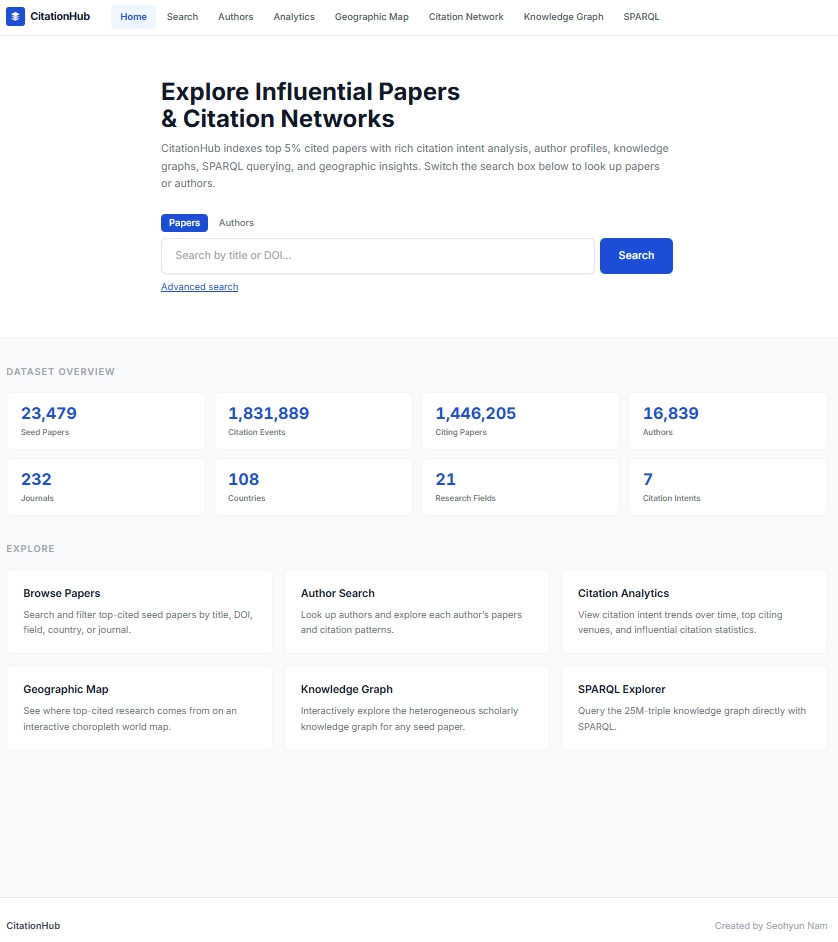
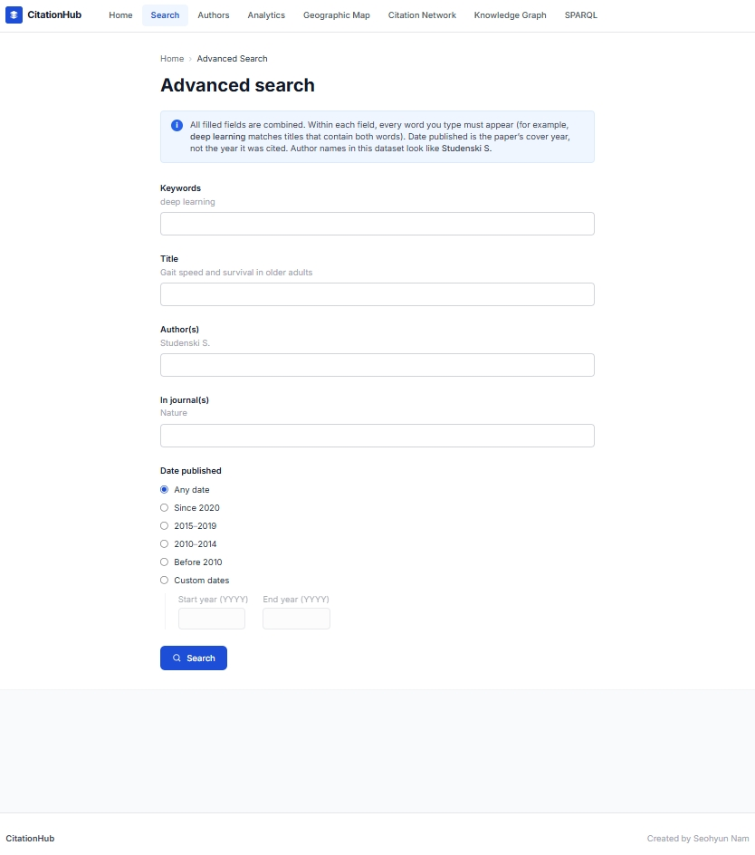
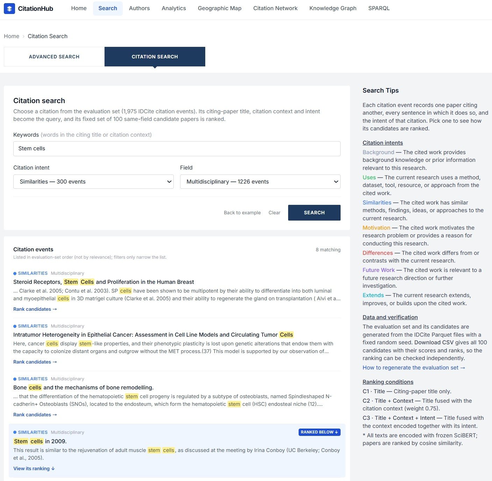

# CitationHub



**CitationHub** is an interactive exploration system built on **IDCite**, a large-scale multidisciplinary citation-event dataset. It lets readers search influential seed papers and authors, inspect citation intents and contexts, and explore geographic, network, and knowledge-graph views of the same underlying resource.

**Website URL:** [https://citation-hub-website.vercel.app](https://citation-hub-website.vercel.app)

This repository explains how CitationHub is organized and how it uses IDCite. It is written for readers who want to **understand** the system, **not** to **rebuild** or **redeploy** it.

**🎥 Watch the CitationHub System in action:** [Watch the interactive demo](https://app.arcade.software/share/videos/19ledKuzOhMuJOPhVr4K)

---

## System Overview

The home page is the entry point to the system.

- The **top navigation** lists eight modules: Home, Search, Authors, Analytics, Geographic Map, Citation Network, Knowledge Graph, and SPARQL.
- The **hero search box** switches between Papers (title or DOI) and Authors. Under the paper search box, **Advanced search** opens a fielded form (title, author, journal, publication year).
- **Dataset Overview** reports the scale currently served by the interactive system (seed papers, citation events, citing papers, authors, journals, countries, fields, and citation intents).
- **Explore** links to the six analysis modules.

The numbers on the home page describe the live index. The full IDCite release is larger and is documented in [Data layer](#data-layer-idcite).

---

## Features

Each navigation tab is a separate view over the same IDCite tables.

### Home

The landing page introduces the corpus, provides paper/author search, and summarizes dataset scale. The Explore cards jump to Search, Authors, Analytics, Geographic Map, Knowledge Graph, and SPARQL. The paper search box includes an **Advanced search** link to `/search/advanced`.

### Search

Keyword search over seed-paper titles and DOIs, with Field, Country, and Journal filters, pagination, and CSV export. Opening a result leads to the **paper detail** page. The same page also accepts the fielded query produced by Advanced search (`title`, `author`, `journal`, `year_min`, `year_max`).

### Advanced search



`/search/advanced` is a fielded form over the seed-paper catalogue, reached from Home (and from the paper search bar). It is not a separate data source: the same `/search` results page and `/api/search` filters serve both the simple box and this form.

- **Keywords** match tokens in the title or DOI.
- **Title**, **Author(s)**, and **In journal(s)** each search that bibliographic field.
- Filled fields are combined with AND. Within a field, every whitespace-separated word must appear (substring match). Example: `deep learning` keeps papers whose title or DOI contains both words.
- Author strings in IDCite follow Scopus style (`Studenski S.`), not a full given name.
- **Date published** is the seed paper’s cover year, not the year it was cited. Presets: Any date, Since 2020, 2015–2019, 2010–2014, Before 2010, or a custom YYYY–YYYY range.

### Citation search



`/search/citation` sits in a tab next to Advanced search and is also linked under the paper search box on Home. Instead of matching words in titles, it recommends **which seed paper to cite at a specific point in a manuscript**.

- **Field** (optional) limits the candidates to one of the 21 scientific fields.
- **Paper title** is the title of the manuscript being written; a working title is fine.
- **Citation context** is the sentence from the manuscript where a reference is needed, for example `… on the GOT-10k benchmark [?].`
- **Citation intent** is the role the reference plays in that sentence: Background, Uses, Similarities, Motivation, Differences, Future Work, or Extends. Several can be selected; Search Tips explains each one.
- By default only papers that IDCite records as cited with a selected intent are ranked.

The 15 best-matching seed papers are listed. Each shows its citation counts per intent and, on request, the citation contexts in which other papers cited it with that intent — evidence of *how* the paper has been used for that purpose. **Open in Citation Network** shows the same paper filtered to those intents. The form opens with a sample query (the title and one citing sentence of a real IDCite citing paper) so it can be tried with one click; results are numbered in rank order only.

**Ranking framework.** Results are ordered by a **citation-context-aware ranking**, **not** by *citation counts* or *PageRank*:

1. A frozen SciBERT encoder turns text into vectors. Each seed paper is represented once by its bibliographic metadata (title, journal, creator, field, category).
2. The paper title and the citation context are encoded separately and combined into one query vector (context weight 0.75), so the ranking reflects both the topic of the manuscript and what is being said at the point of citation.
3. Seed papers are ranked by cosine similarity to the query.
4. The citation intent selects the candidates and the evidence rather than changing the query: only papers that IDCite records as cited with the selected intent are ranked, and the citation contexts shown for each result are those with that intent.

### Authors

Author-name search grouped by author identifier. Each card shows affiliation, country, primary field, seed-paper count, and total citations. Opening a card leads to the **author detail** page: profile metadata, seed papers, citation-intent distribution, citations over time, and top citing venues.

### Analytics

Global statistics across citation events:

- citation-intent distribution
- share of citations marked influential
- intent trends by year
- top citing venues

### Geographic Map

A world map of seed-paper counts with three switchable layers — **by country** (choropleth with country names), **by city**, and **by affiliation** (bubbles sized by paper count). All three layers are labelled automatically. Ranked lists of top countries, cities, and affiliations sit under the map. IDCite names cities and affiliations but carries no coordinates; CitationHub places them with a GeoNames lookup shipped with the application.

### Citation Network

A force-directed network for a selected seed paper. Citing papers are nodes colored by primary citation intent (`background`, `uses`, `similarities`, `motivation`, `differences`, `future_work`, `extends`). Drag to pan, scroll to zoom, and click a node for details.

### Knowledge Graph

A heterogeneous graph around a seed paper: papers, citation events, authors, journals, affiliations, cities, countries, fields, and intents. A second tab, **Citation Event Schema**, shows the class/relation diagram used by the graph and SPARQL views.

### SPARQL

A read-only SPARQL explorer over the RDF knowledge graph (about 25 million triples). Users can run prepared example queries or write SELECT / ASK / CONSTRUCT / DESCRIBE queries, inspect an ontology panel, and download results as CSV. Write operations are not allowed.

### Paper detail

Not a navigation tab, but reachable from Search, Citation Network, and Knowledge Graph. It shows bibliographic metadata, intent distribution, citing papers, co-cited papers, citation-context snippets, a knowledge-graph shortcut, and CSV export of that paper’s citation events.

More screen-level detail is in [`docs/features.md`](docs/features.md).

---

## Data layer: IDCite

CitationHub is the application layer. **IDCite** is the data layer: 17 Apache Parquet tables of citation events, publication metadata, normalized scholarly entities, and a supplementary knowledge graph.

| Measure (IDCite release) | Value |
|---|---|
| Citation events | 1,857,503 |
| Citing papers | 1,467,045 |
| Seed (cited) papers | 23,479 |
| ESI fields | 21 |
| Q1 journals in the sampling frame | 105 |
| Knowledge-graph nodes / edges | 3,418,433 / 6,855,117 |
| Data snapshot | November 2025 |

The interactive system reads a working subset of those tables (normalized seed papers, normalized citation events, the author lookup, and the knowledge-graph node/edge files). Geographic Map uses city, country, and affiliation names already on the seed-paper table, plus a separate coordinate lookup derived from GeoNames — not from IDCite. The remaining tables are part of the public dataset release.

**Where to get the 17 Parquet files**

| Resource | Location |
|---|---|
| IDCite Version 3 (Zenodo) | [https://doi.org/10.5281/zenodo.20796923](https://doi.org/10.5281/zenodo.20796923) |
| Processed dataset mirror (Hugging Face) | [https://huggingface.co/datasets/Daniel0315/IDCite](https://huggingface.co/datasets/Daniel0315/IDCite) |
| Dataset Construction pipeline | [https://github.com/SeohyunNam/MDCite](https://github.com/SeohyunNam/MDCite) |

File-by-file inventory and schemas: [`docs/data.md`](docs/data.md).

---

## System Architecture

CitationHub separates the public interface from the data and query services.

```
Browser
   │
   ▼
Next.js frontend  (search, analytics, maps, graphs, SPARQL editor)
   │  HTTPS API
   ▼
FastAPI backend
   ├── Parquet tables   (pandas / DuckDB)
   └── read-only SPARQL proxy
            │
            ▼
       SPARQL engine (QLever) serving the RDF knowledge graph
```

- The **frontend** is a Next.js application: paper/author search, charts, a world map (country choropleth plus city and affiliation bubbles), force graphs, and the SPARQL editor.
- The **backend** loads IDCite Parquet files and answers overview, search, paper, author, analytics, geo, and knowledge-graph requests.
- The **RDF layer** is produced from `kg_nodes.parquet` and `kg_edges.parquet`. QLever indexes those triples; the backend forwards read-only SPARQL queries and rejects update operations.

This repository does not include deployment hostnames, internal paths, or credentials. Logical design is in [`docs/architecture.md`](docs/architecture.md).

---

## SPARQL and QLever

The SPARQL page queries a scholarly RDF graph with namespaces:

- resources: `http://citationhub.org/id/`
- ontology: `http://citationhub.org/ontology/` (`ch:`)

**Classes:** SeedPaper, CitingPaper, CitationEvent, Author, Journal, Affiliation, City, Country, Field, Intent

**Relations:** hasAuthor, hasAffiliation, belongsToField, publishedIn, publishedInVenue, locatedInCity, locatedInCountry, hasCitedPaper, hasCitingPaper, hasPrimaryIntent

The SPARQL engine is **QLever**. Example queries: [`examples/sparql/`](examples/sparql/). Ontology notes and references: [`docs/sparql.md`](docs/sparql.md).

---

## Related resources

- **CitationHub system:** [https://citation-hub-website.vercel.app](https://citation-hub-website.vercel.app)
- **IDCite construction pipeline:** [https://github.com/SeohyunNam/MDCite](https://github.com/SeohyunNam/MDCite)
- **IDCite dataset (Zenodo v3):** [https://doi.org/10.5281/zenodo.20796923](https://doi.org/10.5281/zenodo.20796923)
- **IDCite mirror (Hugging Face):** [https://huggingface.co/datasets/Daniel0315/IDCite](https://huggingface.co/datasets/Daniel0315/IDCite)
- **IDCite project page:** [https://seohyunnam.github.io/IDCite-Website/](https://seohyunnam.github.io/IDCite-Website/)

---

## Creator

Seohyun Nam, Department of Computer Engineering, Chung-Ang University  
Seohyun0315@cau.ac.kr

---

## License

Documentation in this repository is licensed under [Creative Commons Attribution 4.0 International (CC BY 4.0)](https://creativecommons.org/licenses/by/4.0/). Reuse of IDCite itself follows the dataset license and the terms of the upstream scholarly sources.
