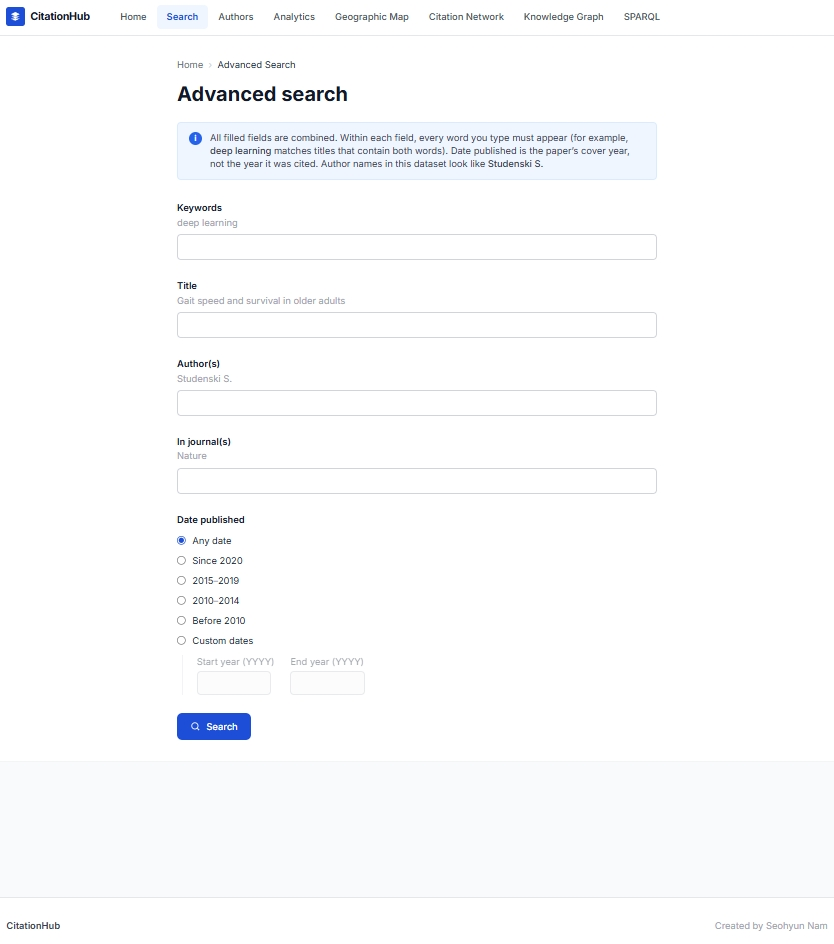

# CitationHub features

This page describes each user-facing view in the live system. The home screenshot in the [README](../README.md) shows the navigation bar that these sections follow.

Website URL: [https://citation-hub-website.vercel.app](https://citation-hub-website.vercel.app)

---

## Home (`/`)

Home is the orientation page.

- **Papers / Authors toggle** in the search box. Papers search by title or DOI; Authors search by name.
- Under the paper search box, **Advanced search** opens `/search/advanced`.
- **Dataset Overview** cards report the live index: seed papers, citation events, citing papers, authors, journals, countries, research fields, and citation intents.
- **Explore** cards link to Browse Papers, Author Search, Citation Analytics, Geographic Map, Knowledge Graph, and SPARQL Explorer.

The footer reads “Created by Seohyun Nam”.

---

## Search (`/search`)

Search is the catalogue of highly cited **seed papers**.

- Token-based matching on titles and DOIs (not only exact strings).
- Sidebar filters: **Field**, **Country**, **Journal**.
- Pagination and **Export CSV**.
- Each result card opens **paper detail**.
- Query parameters from Advanced search (`title`, `author`, `journal`, `year_min`, `year_max`) are applied together with the sidebar filters.

---

## Advanced search (`/search/advanced`)

Advanced search is a fielded form over the same seed-paper table as Search. It does not query a second index.

- **Keywords** → title or DOI tokens (`q`).
- **Title**, **Author(s)**, **In journal(s)** → those columns on the normalized seed-paper table (`creator` is stored as Scopus-style names such as `Studenski S.`).
- Every filled field must match (AND across fields). Every word inside a field must appear (AND within a field; substring, not Boolean OR/NOT).
- **Date published** filters the paper’s cover year. Radio presets cover Any date, Since 2020, 2015–2019, 2010–2014, Before 2010, plus custom start/end years. This is not the citing-paper year used on Analytics or paper-detail citation events.
- Submit navigates to `/search` with those query parameters. **Edit advanced search** returns to the form with the same values.

---

## Authors (`/authors`)

Authors is a name search over seed-paper creators, grouped by `author_id`.

Each result shows:

- name, affiliation, and country
- primary research field
- number of seed papers
- total citations of those papers

Selecting an author opens **author detail** (`/authors/[id]`):

- affiliations, fields, and countries
- seed-paper count, total citations, and citation-event count
- **Citation Intent Distribution** — why the author’s papers are cited
- citations over time
- top citing venues
- list of the author’s seed papers

---

## Analytics (`/analytics`)

Analytics summarizes **all citation events** currently indexed.

| Panel | What it shows |
|---|---|
| Citation Intent Distribution | Counts for the seven canonical intents |
| Influential Citations | Share of events marked influential |
| Citation Intent Trend Over Time | Intent mix by citing year |
| Top Citing Venues | Journals and preprint servers that cite seed papers most often |

Canonical intents: `background`, `uses`, `similarities`, `motivation`, `differences`, `future_work`, `extends`.

---

## Geographic Map (`/geo`)

Geographic Map locates seed-paper authors and affiliations. A view switch offers three layers over the same world map:

| Layer | What it draws |
|---|---|
| **By country** | Choropleth of paper counts (darker = more papers), with country names on the land |
| **By city** | One bubble per city, sized by paper count, labelled with the city name |
| **By affiliation** | One bubble per institution, sized by paper count, labelled with the institution name |

- Labels are placed automatically, avoiding one another; more names appear as the map is zoomed in.
- Hovering a country, city, or institution reports its paper count.
- Ranked bar charts under the map: **Top Countries**, **Top Cities**, **Top Affiliations**. Each bubble layer is coloured to match its bar chart.

### Where the coordinates come from

IDCite names the city and country of every affiliation but carries no latitude or longitude, so the map cannot be drawn from the dataset alone. CitationHub resolves the dataset’s 1,935 distinct city–country pairs against the [GeoNames](https://www.geonames.org) gazetteer (CC BY 4.0) in advance and ships the resulting lookup table with the application; nothing is geocoded at request time. Matching is done per country and accounts for spelling differences between bibliographic metadata and the gazetteer — accents, alternate names, and same-name towns such as Princeton, NJ and Princeton, FL. The current lookup resolves 1,842 pairs, covering 99.3% of papers that record a city; the remainder are mostly hamlets and typos in the source metadata and are left off the map.

Institutions have no coordinates of their own either, since IDCite locates an affiliation no more precisely than its city. Each is therefore drawn on its city’s position, and institutions sharing a city are fanned out around that point so that each keeps its own bubble, label, and hover target. That fan-out is a drawing device rather than a measured position, and it is held to a fixed size on screen so the ground distance it implies shrinks as the reader zooms in.

---

## Citation Network (`/network`)

Citation Network shows **who cites a chosen seed paper, and with what intent**.

- A seed-paper selector (titles of highly cited papers).
- Force-directed graph: the seed paper is the center node; citing papers are colored by primary intent.
- Node size reflects available citation-context evidence.
- Click a node for title, year, and intent; open **View Detail** for the full paper page.
- Click intents in the legend to filter. A filter counts every IDCite citation event carrying that intent, including events with two labels.
- Up to 500 citing papers are drawn (most citation contexts first); the legend says when more exist.
- **Download citation events (CSV)** exports every citation event shown, with its IDCite `citation_event_id` and citation contexts.

This view is a citation neighborhood, not the full heterogeneous knowledge graph.

---

## Knowledge Graph (`/kg`)

Knowledge Graph shows **typed scholarly entities** around a seed paper.

**Knowledge Graph tab**

- Paper selector and a force graph of related nodes.
- Node types: seed paper, citing paper, citation event, journal, author, affiliation, city, country, field, intent.
- Pan, zoom, and click a node for its type and label.

**Citation Event Schema tab**

- Schema diagram: a `CitationEvent` links a `CitingPaper` to a `SeedPaper` with an intent, and seed papers link to journals, authors, affiliations, geography, and fields.
- Lists of edge types and node attributes.

---

## SPARQL (`/sparql`)

SPARQL is a query console over the RDF graph derived from IDCite (about 25.1 million triples).

- Example queries: most-cited seed papers, intent distribution, top fields, top authors, top countries, total triples.
- Ontology panel: classes, relations, and data properties.
- Editor for SELECT / ASK / CONSTRUCT / DESCRIBE.
- Results table and CSV download.
- Update operations (INSERT, DELETE, and similar) are rejected.

Example query files: [`../examples/sparql/`](../examples/sparql/). Technical notes: [`sparql.md`](sparql.md).

---

## Paper detail (`/papers/[id]`)

Paper detail is opened from Search, Citation Network, or Knowledge Graph.

Header: title, field, country, DOI, cited-by count, citation-event count, publication date, journal, author, affiliation, and city. Shortcuts: **View Knowledge Graph** (opens the Knowledge Graph on this paper) and **Export Citations CSV**.

Inner tabs:

| Tab | Content |
|---|---|
| Overview | Intent distribution (an event with two intent labels counts under both) and summary statistics |
| Citing Papers | Papers that cite this seed paper. The tab shows the total number and lists them 20 per page (most citation contexts first), with numbered pages to reach the rest; **Export Citations CSV** has all of them. Each title opens its DOI page, or its Semantic Scholar page when it has no DOI |
| Co-cited | Other seed papers co-cited with this one, with the total number, 20 per page (most co-citations first); each title opens its DOI page, and **View in CitationHub** opens its paper detail |

---

## How the views share data

All of these pages read IDCite. Search and paper detail use normalized seed papers and citation events. Authors use the author lookup plus seed-paper metadata. Analytics aggregates citation events. Geographic Map counts the city, country, and affiliation names recorded on seed papers and places them with the bundled coordinate lookup. Citation Network uses citing-paper lists for one seed paper. Knowledge Graph and SPARQL use the node/edge tables and the RDF conversion of those tables.

---

## References

These papers are recommended background for the ideas behind each view. They are not CitationHub publications.

### Search and Advanced search

Matching seed papers are ordered by their citation count, a query-independent importance score of the kind long used in web and scholarly search.

1. Sergey Brin and Lawrence Page. **The Anatomy of a Large-Scale Hypertextual Web Search Engine.** *Computer Networks and ISDN Systems* 30(1–7), 1998, pp. 107–117. https://doi.org/10.1016/S0169-7552(98)00110-X

2. Jöran Beel and Bela Gipp. **Google Scholar's Ranking Algorithm: An Introductory Overview.** In *Proceedings of the 12th International Conference on Scientometrics and Informetrics (ISSI)*, 2009, pp. 230–241. https://www.issi-society.org/proceedings/issi_2009/ISSI2009-proc-vol1_Aug2009_batch2-paper-1.pdf

### Citation intents (Authors, Analytics, Citation Network, Paper detail)

The seven intents describe the function for which a paper is cited. The papers below introduced citation-function classification and its use in studying scientific fields, and show systems that display citation contexts and intents.

3. Simone Teufel, Advaith Siddharthan, and Dan Tidhar. **Automatic Classification of Citation Function.** In *Proceedings of EMNLP*, 2006, pp. 103–110. https://aclanthology.org/W06-1613

4. David Jurgens, Srijan Kumar, Raine Hoover, Dan McFarland, and Dan Jurafsky. **Measuring the Evolution of a Scientific Field through Citation Frames.** *Transactions of the Association for Computational Linguistics* 6, 2018, pp. 391–406. https://doi.org/10.1162/tacl_a_00028

5. Arman Cohan, Waleed Ammar, Madeleine van Zuylen, and Field Cady. **Structural Scaffolds for Citation Intent Classification in Scientific Publications.** In *Proceedings of NAACL-HLT*, 2019, pp. 3586–3596. https://doi.org/10.18653/v1/N19-1361

6. Anne Lauscher, Brandon Ko, Bailey Kuehl, Sophie Johnson, Arman Cohan, David Jurgens, and Kyle Lo. **MultiCite: Modeling Realistic Citations Requires Moving Beyond the Single-Sentence Single-Label Setting.** In *Proceedings of NAACL-HLT*, 2022, pp. 1875–1889. https://doi.org/10.18653/v1/2022.naacl-main.137

7. Josh M. Nicholson, Milo Mordaunt, Patrice Lopez, Ashish Uppala, Domenic Rosati, Neves P. Rodrigues, Peter Grabitz, and Sean C. Rife. **scite: A Smart Citation Index that Displays the Context of Citations and Classifies Their Intent Using Deep Learning.** *Quantitative Science Studies* 2(3), 2021, pp. 882–898. https://doi.org/10.1162/qss_a_00146

### Analytics

Background for the influential-citation share and for reading citation activity over time.

8. Marco Valenzuela, Vu Ha, and Oren Etzioni. **Identifying Meaningful Citations.** In *AAAI Workshop on Scholarly Big Data* (Technical Report WS-15-13), 2015, pp. 21–26. https://cdn.aaai.org/ocs/ws/ws0121/10185-46008-1-PB.pdf

9. Chaomei Chen. **CiteSpace II: Detecting and Visualizing Emerging Trends and Transient Patterns in Scientific Literature.** *Journal of the American Society for Information Science and Technology* 57(3), 2006, pp. 359–377. https://doi.org/10.1002/asi.20317

### Citation Network and Paper detail

Citation indexing, co-citation (the **Co-cited** tab of paper detail), and earlier tools for exploring citation networks.

10. Eugene Garfield. **Citation Indexes for Science: A New Dimension in Documentation through Association of Ideas.** *Science* 122(3159), 1955, pp. 108–111. https://doi.org/10.1126/science.122.3159.108

11. Henry Small. **Co-Citation in the Scientific Literature: A New Measure of the Relationship Between Two Documents.** *Journal of the American Society for Information Science* 24(4), 1973, pp. 265–269. https://doi.org/10.1002/asi.4630240406

12. Nees Jan van Eck and Ludo Waltman. **CitNetExplorer: A New Software Tool for Analyzing and Visualizing Citation Networks.** *Journal of Informetrics* 8(4), 2014, pp. 802–823. https://doi.org/10.1016/j.joi.2014.07.006

13. Niklas Elmqvist and Philippas Tsigas. **CiteWiz: A Tool for the Visualization of Scientific Citation Networks.** *Information Visualization* 6, 2007, pp. 215–232. https://doi.org/10.1057/palgrave.ivs.9500156

14. Jason Portenoy, Jessica Hullman, and Jevin D. West. **Leveraging Citation Networks to Visualize Scholarly Influence Over Time.** *Frontiers in Research Metrics and Analytics* 2, 2017, Article 8. https://doi.org/10.3389/frma.2017.00008

### Knowledge Graph

Knowledge graphs in general, knowledge graphs for scholarly communication, and ontologies for bibliographic resources and citations.

15. Aidan Hogan et al. **Knowledge Graphs.** *ACM Computing Surveys* 54(4), 2021, Article 71. https://doi.org/10.1145/3447772

16. Sören Auer, Viktor Kovtun, Manuel Prinz, Anna Kasprzik, Markus Stocker, and Maria-Esther Vidal. **Towards a Knowledge Graph for Science.** In *Proceedings of the 8th International Conference on Web Intelligence, Mining and Semantics (WIMS)*, 2018, pp. 1:1–1:6. https://doi.org/10.1145/3227609.3227689

17. Mohamad Yaser Jaradeh, Allard Oelen, Kheir Eddine Farfar, Manuel Prinz, Jennifer D'Souza, Gábor Kismihók, Markus Stocker, and Sören Auer. **Open Research Knowledge Graph: Next Generation Infrastructure for Semantic Scholarly Knowledge.** In *Proceedings of the 10th International Conference on Knowledge Capture (K-CAP)*, 2019, pp. 243–246. https://doi.org/10.1145/3360901.3364435

18. Waleed Ammar et al. **Construction of the Literature Graph in Semantic Scholar.** In *Proceedings of NAACL-HLT (Industry Papers)*, 2018, pp. 84–91. https://doi.org/10.18653/v1/N18-3011

19. Silvio Peroni and David Shotton. **FaBiO and CiTO: Ontologies for Describing Bibliographic Resources and Citations.** *Journal of Web Semantics* 17, 2012, pp. 33–43. https://doi.org/10.1016/j.websem.2012.08.001

### SPARQL

The SPARQL engine and the W3C standards behind it are listed in [`sparql.md`](sparql.md#references).
