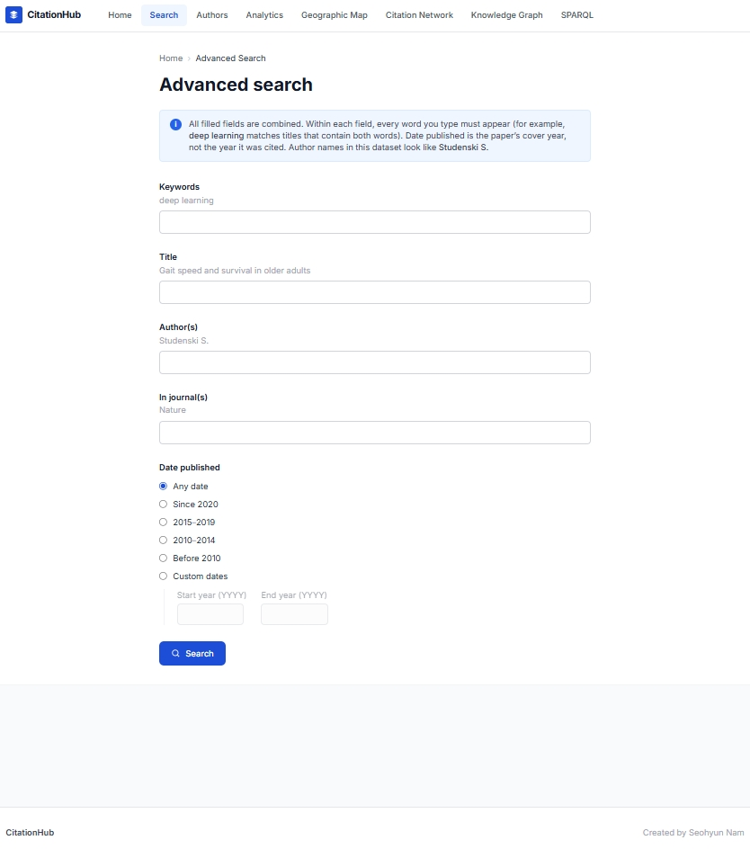
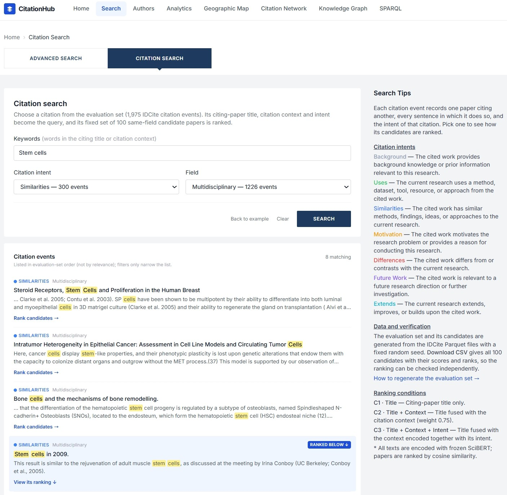

# CitationHub features

This page describes each user-facing view in the live system. The home screenshot in the [README](../README.md) shows the navigation bar that these sections follow.

Website URL: [https://citation-hub-website.vercel.app](https://citation-hub-website.vercel.app)

---

## Home (`/`)

Home is the orientation page.

- **Papers / Authors toggle** in the search box. Papers search by title or DOI; Authors search by name.
- Under the paper search box, **Advanced search** opens `/search/advanced`.
- **Dataset Overview** cards report the live index: seed papers, citation events, citing papers, authors, journals, countries, research fields, and citation intents.
- **Explore** cards link to Browse Papers, Author Search, Citation Analytics, Geographic Map, Knowledge Graph, and SPARQL Explorer.

The footer reads “Created by Seohyun Nam”.

---

## Search (`/search`)

Search is the catalogue of highly cited **seed papers**.

- Token-based matching on titles and DOIs (not only exact strings).
- Sidebar filters: **Field**, **Country**, **Journal**.
- Pagination and **Export CSV**.
- Each result card opens **paper detail**.
- Query parameters from Advanced search (`title`, `author`, `journal`, `year_min`, `year_max`) are applied together with the sidebar filters.

---

## Advanced search (`/search/advanced`)

Advanced search is a fielded form over the same seed-paper table as Search. It does not query a second index.

- **Keywords** → title or DOI tokens (`q`).
- **Title**, **Author(s)**, **In journal(s)** → those columns on the normalized seed-paper table (`creator` is stored as Scopus-style names such as `Studenski S.`).
- Every filled field must match (AND across fields). Every word inside a field must appear (AND within a field; substring, not Boolean OR/NOT).
- **Date published** filters the paper’s cover year. Radio presets cover Any date, Since 2020, 2015–2019, 2010–2014, Before 2010, plus custom start/end years. This is not the citing-paper year used on Analytics or paper-detail citation events.
- Submit navigates to `/search` with those query parameters. **Edit advanced search** returns to the form with the same values.

---

## Citation search (`/search/citation`)

Citation search runs on real IDCite citation events. It is reached from the tab next to Advanced search and from the **Citation search** link under the paper search box on Home.

- **Keywords** (citing title or citation context), **Citation intent**, and **Field** filter the 1,975 citation events of the evaluation set; the list is paginated, ten events per page.
- The list keeps the evaluation-set order, not relevance; a note under its heading says so. Filters only narrow the list.
- Opened without a query, the page runs an example search (*Stem cells*, Similarities, Multidisciplinary) and ranks one of its events; a new search or another event replaces it.
- Keywords match the start of a word (*stem* finds "stem" and "stems", not "system") and are highlighted in yellow; each context excerpt starts near its first match.
- When the example event is shown, a short note above it explains that it is the example.
- **Back to example** (next to **Clear**) returns to the example search from any search; **Clear** only empties the form. Every new search clears the selected event, so an earlier ranking is not left on screen.
- **Rank candidates** uses the selected event's citing title, citation context, and intent as the query and ranks its fixed set of 100 same-field candidate papers. The selected event is highlighted in the list with a **Ranked below** label, and its button becomes **View its ranking**, which scrolls to the result.
- The result shows the event (citing paper title, citing citation context, intent), the paper it cites with its rank under C1, C2, and C3 (**Show evidence** there reveals the IDCite `citation_event_id` recording the citation, the CSV link, and the generation guide), and the top 10 candidates for the condition chosen with the C1 / C2 / C3 tabs.
- Each candidate card shows bibliographic metadata, score and ranks, citation counts per intent, **Show citation contexts** (other IDCite citations of that paper with the same intent; the query's own citing paper is excluded), and **Open in Citation Network**.
- **Download CSV** returns all 100 candidates with `is_cited_target`, scores, and ranks.
- Search Tips list the seven citation intents, describe the data and how it can be verified (with a link to [`evaluation-dataset.md`](evaluation-dataset.md), which explains how to regenerate the set), and explain the three ranking conditions.
- The query and selection are kept in the URL, so a result page can be shared.

---

## Authors (`/authors`)

Authors is a name search over seed-paper creators, grouped by `author_id`.

Each result shows:

- name, affiliation, and country
- primary research field
- number of seed papers
- total citations of those papers

Selecting an author opens **author detail** (`/authors/[id]`):

- affiliations, fields, and countries
- seed-paper count, total citations, and citation-event count
- **Citation Intent Distribution** — why the author’s papers are cited
- citations over time
- top citing venues
- list of the author’s seed papers

---

## Analytics (`/analytics`)

Analytics summarizes **all citation events** currently indexed.

| Panel | What it shows |
|---|---|
| Citation Intent Distribution | Counts for the seven canonical intents |
| Influential Citations | Share of events marked influential |
| Citation Intent Trend Over Time | Intent mix by citing year |
| Top Citing Venues | Journals and preprint servers that cite seed papers most often |

Canonical intents: `background`, `uses`, `similarities`, `motivation`, `differences`, `future_work`, `extends`.

---

## Geographic Map (`/geo`)

Geographic Map locates seed-paper authors and affiliations. A view switch offers three layers over the same world map:

| Layer | What it draws |
|---|---|
| **By country** | Choropleth of paper counts (darker = more papers), with country names on the land |
| **By city** | One bubble per city, sized by paper count, labelled with the city name |
| **By affiliation** | One bubble per institution, sized by paper count, labelled with the institution name |

- Labels are placed automatically, avoiding one another; more names appear as the map is zoomed in.
- Hovering a country, city, or institution reports its paper count.
- Ranked bar charts under the map: **Top Countries**, **Top Cities**, **Top Affiliations**. Each bubble layer is coloured to match its bar chart.

### Where the coordinates come from

IDCite names the city and country of every affiliation but carries no latitude or longitude, so the map cannot be drawn from the dataset alone. CitationHub resolves the dataset’s 1,935 distinct city–country pairs against the [GeoNames](https://www.geonames.org) gazetteer (CC BY 4.0) in advance and ships the resulting lookup table with the application; nothing is geocoded at request time. Matching is done per country and accounts for spelling differences between bibliographic metadata and the gazetteer — accents, alternate names, and same-name towns such as Princeton, NJ and Princeton, FL. The current lookup resolves 1,842 pairs, covering 99.3% of papers that record a city; the remainder are mostly hamlets and typos in the source metadata and are left off the map.

Institutions have no coordinates of their own either, since IDCite locates an affiliation no more precisely than its city. Each is therefore drawn on its city’s position, and institutions sharing a city are fanned out around that point so that each keeps its own bubble, label, and hover target. That fan-out is a drawing device rather than a measured position, and it is held to a fixed size on screen so the ground distance it implies shrinks as the reader zooms in.

---

## Citation Network (`/network`)

Citation Network shows **who cites a chosen seed paper, and with what intent**.

- A seed-paper selector (titles of highly cited papers).
- Force-directed graph: the seed paper is the center node; citing papers are colored by primary intent.
- Node size reflects available citation-context evidence.
- Click a node for title, year, and intent; open **View Detail** for the full paper page.
- Click intents in the legend to filter. A filter counts every IDCite citation event carrying that intent, including events with two labels, so the numbers match the intent counts on Citation search.
- Up to 500 citing papers are drawn (most citation contexts first); the legend says when more exist.
- **Download citation events (CSV)** exports every citation event shown, with its IDCite `citation_event_id` and citation contexts.

This view is a citation neighborhood, not the full heterogeneous knowledge graph.

---

## Knowledge Graph (`/kg`)

Knowledge Graph shows **typed scholarly entities** around a seed paper.

**Knowledge Graph tab**

- Paper selector and a force graph of related nodes.
- Node types: seed paper, citing paper, citation event, journal, author, affiliation, city, country, field, intent.
- Pan, zoom, and click a node for its type and label.

**Citation Event Schema tab**

- Schema diagram: a `CitationEvent` links a `CitingPaper` to a `SeedPaper` with an intent, and seed papers link to journals, authors, affiliations, geography, and fields.
- Lists of edge types and node attributes.

---

## SPARQL (`/sparql`)

SPARQL is a query console over the RDF graph derived from IDCite (about 25.1 million triples).

- Example queries: most-cited seed papers, intent distribution, top fields, top authors, top countries, total triples.
- Ontology panel: classes, relations, and data properties.
- Editor for SELECT / ASK / CONSTRUCT / DESCRIBE.
- Results table and CSV download.
- Update operations (INSERT, DELETE, and similar) are rejected.

Example query files: [`../examples/sparql/`](../examples/sparql/). Technical notes: [`sparql.md`](sparql.md).

---

## Paper detail (`/papers/[id]`)

Paper detail is opened from Search, Citation Network, or Knowledge Graph.

Header: title, field, country, DOI, cited-by count, citation-event count, publication date, journal, author, affiliation, and city. Shortcuts: **View Knowledge Graph** (opens the Knowledge Graph on this paper) and **Export Citations CSV**.

Inner tabs:

| Tab | Content |
|---|---|
| Overview | Intent distribution and summary statistics |
| Citing Papers | Papers that cite this seed paper; each title opens its DOI page, or its Semantic Scholar page when it has no DOI |
| Co-cited | Other seed papers co-cited with this one; each title opens its DOI page, and **View in CitationHub** opens its paper detail |

---

## How the views share data

All of these pages read IDCite. Search and paper detail use normalized seed papers and citation events. Authors use the author lookup plus seed-paper metadata. Analytics aggregates citation events. Geographic Map counts the city, country, and affiliation names recorded on seed papers and places them with the bundled coordinate lookup. Citation Network uses citing-paper lists for one seed paper. Knowledge Graph and SPARQL use the node/edge tables and the RDF conversion of those tables.
